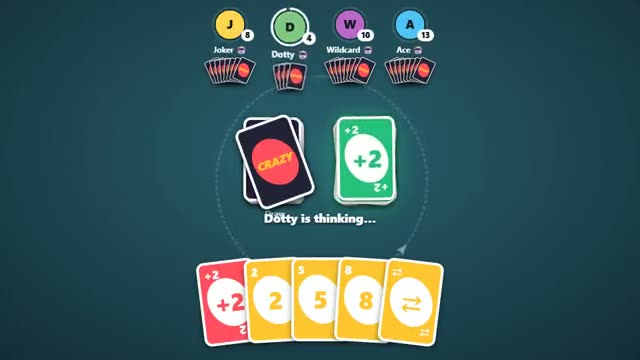

# Crazy Cards

Match the color or number. Empty your hand first. A multiplayer starter game from [Multiplayer Agent](https://multiplayeragent.com): 2D, turn-based, 2–6 players, with bots that fill empty seats.

## How it plays

Play a card that matches the top card by color or number, or a wild. Skip, reverse, +2 and wild +4 change the turn. No match? Draw one. First to empty their hand wins the round.

**Controls:** Click or tap a card, tap the deck to draw.

## Make it yours in the Game Builder

Open the [Game Builder](https://multiplayeragent.com), choose **Start from a starter game** and pick Crazy Cards. It opens as version 1 in your studio, ready to play and publish. Then ask for changes, for example:

- Add a wild card that swaps hands
- Let +2 cards stack
- Add a points mode over five rounds

## Run it yourself

1. Get a free publishable key (`pk_…`) at [multiplayeragent.com](https://multiplayeragent.com).
2. In `index.html`, put it in place of `pk_REPLACE_ME` in the `MP_CONNECT` block.
3. Open `index.html` in a browser. No build step and no server needed.

Without a key it still runs, offline against bots.

## How it is built

- One `index.html`. The comment at the top of the script maps the code and explains the multiplayer.
- **Hidden info:** Your hand is sealed so only you can read it (the host deals, so it can too).
- **Host-run rules:** The host's browser shuffles, deals and checks every card; if it leaves, the next player takes over.
- **Bots:** Bots fill empty seats and take over for anyone who leaves.
- **Leaderboard:** Rounds won, shown after every round.
- `?attract` runs it offline with bots only. The preview video is recorded from it.

## License

MIT.
